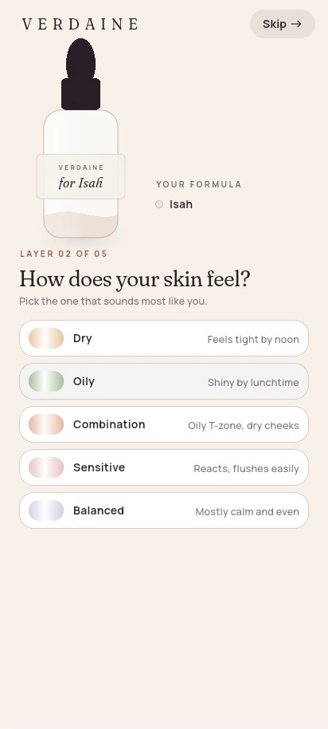
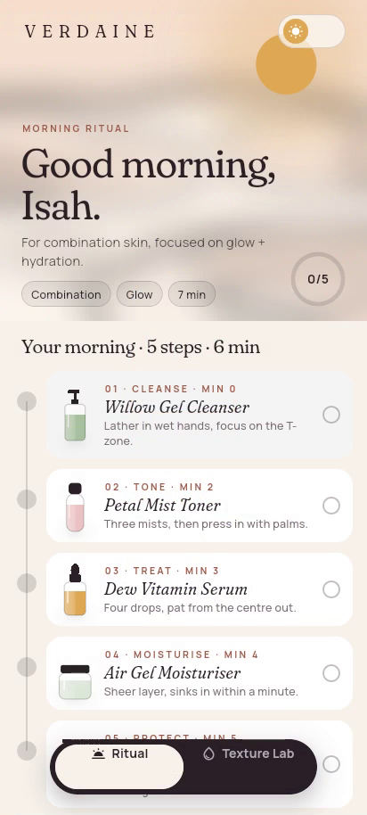
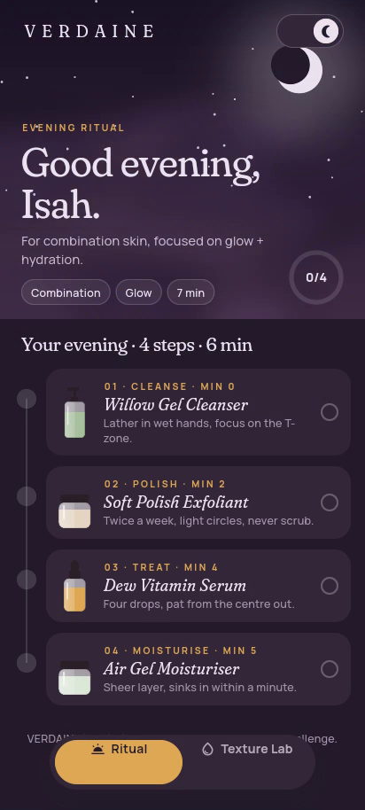
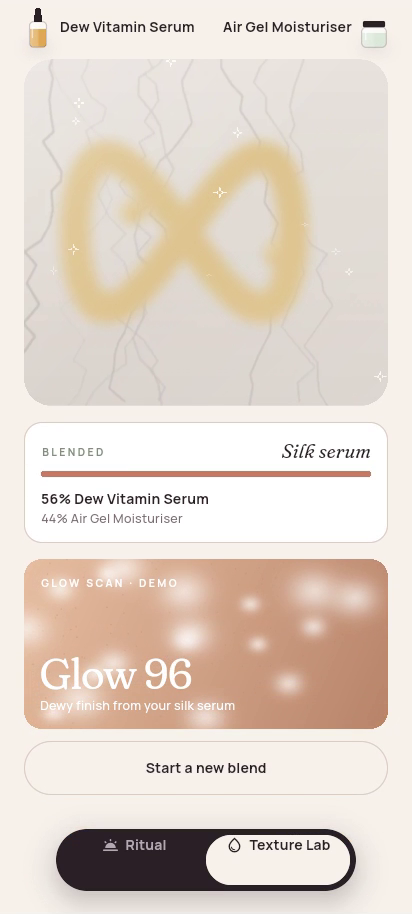

# VERDAINE · Skincare Ritual

Day 7 of my public **10-day Flutter challenge** (2026-10-27): 10 days, 10 brands, 10 apps.
**VERDAINE** is a *fictional* premium skincare brand. It is not a real company and is not affiliated with any skincare maker. Every product name, step and "glow score" in the app is invented, and the glow scan is a playful demo, not a skin analysis. Bottles, jars and backgrounds are drawn in code or generated locally; there are no third-party logos or photos.

| Fill-your-bottle onboarding | Personalised morning ritual | Evening ritual | Texture Lab |
|---|---|---|---|
|  |  |  |  |

## Brand
- **Palette:** Milk `#F7F2EC`, Petal `#EFE2D8`, Ink `#2A2026`, Smoke `#7A6C70`, Clay `#C27B66` (accent), Sage `#7F927A`, Honey `#E0A955`, and for night: Plum `#241B2B`, Moon Milk `#EDE4F0`, Dusk `#A897B0`
- **Type:** Fraunces (with italic) for display and product names, Manrope for body text (both SIL OFL 1.1, bundled).

## What's new today (vs Days 1–6)
- **Onboarding fills your bottle.** A bottle sits at the top of the quiz; every answer pours in a coloured layer with a gentle wave (skin type, your main concern, your ritual moment), and the label writes "for Isah" once you type your name. Questions: name, skin type (5 swatches), concerns (chips, pick several), when you want your ritual (Sunrise / Moonlight / Both) and how many minutes you have (dial, 3–15). **Skip** is visible on every step and goes straight to a balanced starter ritual.
- **Reveal:** the finished bottle turns in 3D: "FORMULATED FOR YOU · Isah, your ritual is ready." with a one-line summary of your answers.
- **Home is a ritual timeline, not a product grid.** A sky header ("Good evening, Isah. For combination skin, focused on glow + hydration.") with your answers as chips and a progress ring, then a vertical timeline of steps you tick off. A sun/moon toggle flips the whole screen between morning and evening, and the steps change (SPF in the morning; exfoliant or oil at night, depending on your skin).
- **Navigation:** a floating "dew-drop" dock with a sliding pill (Ritual / Texture Lab) instead of a tab bar.
- **Signature: Texture Lab.** Your serum and moisturiser (picked from your answers) sit as two drops on a marble slab. Swirl them together with your finger; the trail blends their colours, a readout shows the texture you're making (water gel → silk serum → milky lotion → soft cream → rich balm, based on which side you swirl on) and the serum/cream split. Once blended, "Scan my glow" runs a light sweep and counts up a fictional Glow score.

### How the answers drive the app
| Answer | What changes |
|---|---|
| Name | Bottle label, reveal title and home greeting |
| Skin type | Which products are picked, whether toner/oil steps appear, the bottle layer colour |
| Concerns | The serum in your ritual and in the Lab (lead concern), whether an eye step or night polish appears, the summary line |
| Ritual moment | Whether home opens in morning or evening mode |
| Minutes | Optional steps are dropped (toner, eye, exfoliant, oil) until the ritual fits your time |

## Architecture
```
lib/
  core/        constants, demo, routing (AppRoutes, AppRouter), theme (tokens), utils (DisplayImage), widgets (AppButton, AppText, AppTextField, …)
  features/
    profile/     domain (SkinProfile, SkinType, SkinConcern, RitualMoment), presentation (ProfileController)
    catalog/     data (LocalProductRepository), domain (Product, StepKind, BottleShape, ProductRepository), presentation (bottle painters)
    onboarding/  domain (OnboardingQuestion, FormulaLayers), presentation (OnboardingController, pour bottle, pickers, demo tour)
    reveal/      presentation (bottle-turn reveal)
    ritual/      domain (RitualPlanner, RitualPlan, RitualStep, RitualMood), presentation (RitualController, sky header, timeline)
    lab/         domain (BlendFormula, BlendResult), presentation (LabController, SwirlCanvas, BlendPainter, GlowScan)
    home/        presentation (HomeShell, DewDock)
```
- **State management: provider.** `ChangeNotifier` controllers: `ProfileController` app-wide (via `MultiProvider` with the `ProductRepository`), `OnboardingController` scoped to the quiz, and `RitualController` + `LabController` created from the saved profile in the home shell.
- Pure Dart logic (RitualPlanner, BlendFormula, FormulaLayers) and all controllers are unit tested; widget tests cover Skip, a full personalised run (name, skin, concerns, moment → greeting and summary), ticking steps, the mood flip and the Lab swirl + scan.

## Performance decisions
- **Narrow rebuilds.** Widgets read state with `context.select` / `Selector`, so ticking a step rebuilds that tile and the ring, not the page; the blend readout only rebuilds when the result changes.
- **Swirling never rebuilds widgets.** Stroke points live in a small `ChangeNotifier` (`SwirlCanvas`) passed as the painter's `repaint:` listenable, capped at 700 points; the controller gets one update per stroke, not per pixel.
- **Paint, don't rebuild.** Bottles, the pour wave, the sky, the timeline rail, the slab blend and the glow scan are `CustomPainter`s inside `RepaintBoundary`s.
- **Off-screen tab sleeps.** Home is an `IndexedStack`; the hidden tab is wrapped in `TickerMode(enabled: false)` so its animations pause.
- **Images decoded at display size.** Background art is WebP (under 6 KB each) loaded through `ResizeImage` at on-screen size, and precached during onboarding.
- **Lazy list.** The ritual is a `CustomScrollView` with `SliverList.builder` and keyed tiles.
- **Strict lints** (`flutter_lints` plus extra rules), `const` constructors throughout.

## Release size
`flutter build apk --release --split-per-abi` (Flutter 3.47.7): **arm64-v8a 17.7 MB**, x86_64 19.1 MB. The three background images add under 12 KB in total.

## Run
```bash
flutter pub get
flutter run                                   # normal
flutter run --dart-define=DEMO_TOUR=true      # plays the hands-free demo tour
flutter test
```

## Licence
MIT. See [LICENSE](LICENSE).
